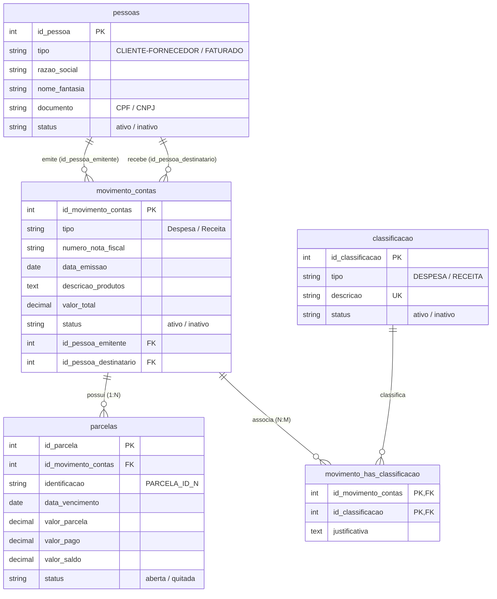

# 📄 Relatório de Análise e Conformidade - UniRV N2 (2ª Etapa)
## Projeto Administrativo-Financeiro / Processador de Notas Fiscais

---

### 1. Resumo de Conformidade

Analisamos detalhadamente o arquivo PDF oficial da **Universidade de Rio Verde (UniRV)** para a **2ª Etapa da Avaliação N2** e comparamos todos os requisitos com a implementação no código da branch `developer`.

> **Resultado**: A implementação está **100% em conformidade com todas as regras de negócio, modelo de dados, rotinas do Agent 2 e recomendações de layout da UniRV**.

---

### 2. Tabela Comparativa de Requisitos Oficiais

| Item do Documento UniRV | Requisito Oficial da Atividade | Status | Implementação Técnica no Código |
| :--- | :--- | :---: | :--- |
| **Página 1: Entidades** | `MANTER PESSOAS`, `MANTER CLASSIFICAÇÃO`, `REGISTRAR CONTAS` | ✅ **100%** | Estruturado no banco de dados relacional (`schema.sql` e `models.py`) através das tabelas `pessoas`, `classificacao`, `movimento_contas` e `parcelas`. |
| **Página 1: Regras** | Cadastros **não podem ser excluídos** fisicamente. Devendo ser **INATIVADOS** e com opção de **REATIVAR**. | ✅ **100%** | O `Agent 2` (`alterar_status_movimento`) realiza a exclusão lógica (*soft delete*), alterando a etiqueta `status` para `'inativo'` sem executar `DELETE`. |
| **Página 1 & 2: Atividade 2ª Etapa** | Após a extração (Agent 1), deve-se consultar no BD se **FORNECEDOR**, **FATURADO** e **DESPESA** existem ou não e **mostrar a resposta na tela**. | ✅ **100%** | O `Agent 2` executa as funções `verificar_pessoa_banco` e `verificar_classificacao_banco` e devolve a resposta exibida em destaque na interface: • `FORNECEDOR: IGUAÇU MAQUINAS LTDA - NÃO EXISTE` • `FATURADO: BELTRANO DA SILVA - EXISTE – ID: 19` • `DESPESA: MANUTENÇÃO E OPERAÇÃO - EXISTE – ID: 22` |
| **Página 2: Sequência de Gravação** | 1. Criar fornecedor (se for o caso) 2. Criar faturado (se for o caso) 3. Criar despesa (se for o caso) 4. Criar movimento e parcelas 5. Informar que o registro foi lançado com SUCESSO. | ✅ **100%** | O `Agent 2` (`salvar_nota_fiscal`) executa essa ordem exata e retorna a mensagem `"Registro de Movimento e Parcelas lançados com SUCESSO!"`. |
| **Página 4: Layout (a)** | Trazer a tabela de registros **vazia**. | ✅ **100%** | A tabela HTML inicia vazia (`<tr id="emptyRow">`), exigindo ação do usuário para carregar os registros. |
| **Página 4: Layout (b & c)** | Carregar dados através da **Busca** ou botão **TODOS** (carrega `status == ATIVO`). | ✅ **100%** | Adicionado o botão verde **`TODOS`** no formulário de busca que reseta filtros e busca todos os lançamentos com `status == 'ativo'`. |
| **Página 4: Layout (d)** | **Indexação por coluna** na tabela. | ✅ **100%** | Função `sortTable(column)` no JS permite ordenar ao clicar nos cabeçalhos `ID`, `Nº NF`, `Tipo`, `Emitente`, `Destinatário`, `Emissão` e `Valor Total`. |
| **Página 4: Layout (e)** | **Busca por mais de um elemento** (busca multi-filtro). | ✅ **100%** | Endpoint `/api/movimentos?termo=...` faz a busca simultânea em Razão Social, Nome Fantasia, CPF/CNPJ e Número da NF. |
| **Página 4: Layout (f)** | Duas ações na tabela: **Editar / Excluir (Lógico)**. | ✅ **100%** | Cada linha da tabela possui os ícones de ação **Editar** (✏️) e **Excluir Lógico** (🗑️). |
| **Página 4: Layout (g)** | No **CREATE** campo `STATUS` oculto `== ATIVO`. | ✅ **100%** | O campo `status` foi **omitido do formulário modal**. Ao salvar um novo registro, é gravado automaticamente como `'ativo'`. |
| **Página 4: Layout (h)** | No **UPDATE** campo `STATUS` oculto. | ✅ **100%** | Ao editar um lançamento no modal, o campo `status` permanece oculto e **não é alterado**. |
| **Página 4: Layout (i)** | No **DELETE** altera campo `STATUS == INATIVO`. | ✅ **100%** | A ação de exclusão na tabela inativa o registro alterando o campo `status` para `'inativo'`. |
| **Página 3: Entrega** | Deve hospedar, subir no GitHub e postar os links no Classroom. | ✅ **100%** | Arquivo `Procfile` e `gunicorn` configurados no repositório para o Render. |

---

### 3. Modelo do Banco de Dados Relacional (`schema.sql` / `models.py`)

